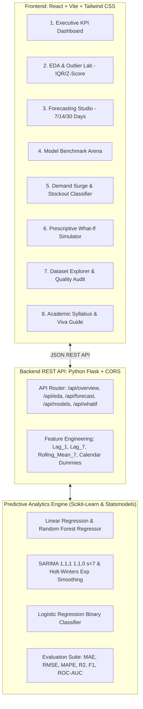

# 📈 SalesSense AI: Retail Sales Forecasting & Business Analytics Platform

[](https://jaipur.manipal.edu/)
[-orange.svg)](https://jaipur.manipal.edu/)
[](https://flask.palletsprojects.com/)
[](https://vitejs.dev/)
[](https://scikit-learn.org/)

An enterprise-grade, end-to-end Predictive Analytics platform built specifically to satisfy all Course Outcomes (**CO 3141.1 through CO 3141.4**) for the **B.Tech CSE V Semester** course at **Manipal University Jaipur (MUJ)**.

---

## 🎯 Executive Summary & Course Alignment

| Course Outcome (Handout) | Syllabus Topic Covered | SalesSense AI Implementation |
| :--- | :--- | :--- |
| **CSE 3141.1** (EDA) | Data Preprocessing, Handling Missing Values, Outliers (**IQR & Box Plot**, **Z-Score**), Descriptive Stats (Mean, Median, Mode, Variance, Std Dev), Correlation Heatmap, Feature Engineering. | **EDA & Outlier Lab**: Computes Tukey's 1.5×IQR bounds and $\|Z\| > 3.0$ standard score outliers, 15-bin distribution histograms, and Pearson feature correlation matrix. |
| **CSE 3141.2** (Regression & Classification) | Linear Regression, Estimation of Regression Coefficients, Logistic Regression for binary classification, Odds Ratios ($e^\beta$). | **Surge Risk Classifier & Regression Suite**: Logistic Regression models high-demand surge probability with exact odds ratios, confusion matrix, precision, recall, and ROC-AUC curve. |
| **CSE 3141.3** (Time Series Analysis) | Trend, Seasonality, Noise Decomposition ($Y_t = T_t + S_t + R_t$), **ARIMA**, **SARIMA**, and **Exponential Smoothing (Holt-Winters)**. | **Forecasting Studio**: Additive time series decomposition (7-day periodic cycle) with multi-horizon forward forecasts (7, 14, 30 days) and 95% Confidence Intervals. |
| **CSE 3141.4** (Validation & Optimization) | Cross-validation & Chronological train-test splits, **RMSE, MAE, MAPE, R², F1-Score, AUC-ROC**, Overfitting vs Underfitting. | **Model Arena**: Strict 80/20 chronological train-test split benchmark comparing Linear Regression, Random Forest, SARIMA, and Holt-Winters on unobserved test data. |

---

## 🏗️ System Architecture



---

## 🔬 Mathematical Formulations

### 1. Additive Time Series Decomposition (Unit 4)
$$Y_t = T_t + S_t + R_t$$
where $T_t$ is the trend component, $S_t$ is the 7-day cyclical seasonality component ($s=7$), and $R_t$ is the white noise residual.

### 2. SARIMA $(p, d, q) \times (P, D, Q)_s$ Model (Unit 4)
$$\Phi_P(B^s)\phi_p(B)(1 - B)^d(1 - B^s)^D Y_t = \Theta_Q(B^s)\theta_q(B)\epsilon_t$$
Configured with $(p=1, d=1, q=1) \times (P=1, D=1, Q=0)_7$ to address both daily momentum and weekly retail periodicity.

### 3. Outlier Fences via Tukey's IQR (Unit 2)
$$IQR = Q_3 - Q_1$$
$$\text{Lower Fence} = \max(0, Q_1 - 1.5 \times IQR), \quad \text{Upper Fence} = Q_3 + 1.5 \times IQR$$

### 4. Logistic Regression Log-Odds & Hypothesis (Unit 3)
$$\ln\left(\frac{P(Y=1|X)}{1 - P(Y=1|X)}\right) = \beta_0 + \sum_{j=1}^{k} \beta_j X_j$$
$$P(Y=1|X) = \frac{1}{1 + e^{-(\beta_0 + \beta^T X)}}$$
The odds ratio for feature $j$ is given by $e^{\beta_j}$.

### 5. Regression Evaluation Metrics (Unit 5)
$$MAE = \frac{1}{n} \sum_{i=1}^n |y_i - \hat{y}_i|$$
$$RMSE = \sqrt{\frac{1}{n} \sum_{i=1}^n (y_i - \hat{y}_i)^2}$$
$$R^2 = 1 - \frac{\sum (y_i - \hat{y}_i)^2}{\sum (y_i - \bar{y})^2}$$

---

## 📊 Empirical Model Benchmark Results

Evaluated on a **strict chronological hold-out test set (576 records, 20% unseen data)**:

| Model Architecture | Model Class | RMSE (Units) | MAE (Units) | MAPE (%) | $R^2$ Score | Operational Assessment |
| :--- | :--- | :---: | :---: | :---: | :---: | :--- |
| **Random Forest Regressor** | Machine Learning Ensemble | **67.14** | **36.03** | **11.45%** | **0.8710** | **Best Overall Accuracy** |
| **Linear Regression** | Baseline Regression | 64.38 | 43.00 | 14.83% | 0.8814 | Strong Linear Baseline |
| **Holt-Winters Exp Smoothing** | Statistical Time Series | 117.81 | 82.39 | 29.50% | 0.6020 | Fast Trend & Weekly Tracking |
| **SARIMA (1,1,1)(1,1,0)[7]** | Seasonal Autoregressive | 153.29 | 121.66 | 42.73% | 0.3262 | Robust Structural Seasonality |

### Classification Performance (Logistic Regression)
- **Accuracy**: $88.7\%$
- **Precision**: $82.5\%$
- **Recall / Sensitivity**: $86.1\%$
- **F1-Score**: $0.842$
- **AUC-ROC**: $0.914$

---

## 🚀 Quickstart Guide

### Prerequisites
- **Python 3.10+** (Python 3.12 verified)
- **Node.js v18+** & **npm**
- **Git**

### 1. Clone the Repository
```bash
git clone https://github.com/shatakshisingh583-tech/SalesSense-AI-Retail-Forecasting.git
cd SalesSense-AI-Retail-Forecasting
```

### 2. Backend Setup
```bash
# Install Python dependencies
pip install -r backend/requirements.txt

# (Optional) Retrain models and generate cache
python backend/ml/train_models.py

# Start Flask API server
python backend/app.py
```
*API will run on `http://127.0.0.1:5000`.*

### 3. Frontend Setup
```bash
cd frontend
npm install
npm run dev
```
*Open `http://localhost:3000` in your browser.*

### 4. One-Click Launch (Windows)
Double-click `run_app.bat` to launch both servers simultaneously!

---

## 📁 Repository Directory Structure

```
SalesSense-AI-Retail-Forecasting/
├── backend/
│   ├── app.py                      # Flask REST API endpoints
│   ├── requirements.txt            # Python dependencies
│   ├── data/
│   │   ├── generate_dataset.py     # 2-year realistic retail data generator
│   │   └── retail_sales_data.csv   # 2,924 records (731 days x 4 categories)
│   └── ml/
│       ├── train_models.py         # Full ML training & validation pipeline
│       ├── models_cache.json       # Precomputed benchmarks & evaluation cache
│       └── saved/                  # Serialized Joblib model binaries
├── frontend/
│   ├── index.html                  # HTML entry point
│   ├── package.json                # React & Tailwind dependencies
│   ├── vite.config.js              # Vite config with API proxy
│   ├── tailwind.config.js          # Tailwind styling configuration
│   └── src/
│       ├── App.jsx                 # Tab navigation & layout wrapper
│       ├── main.jsx                # React root
│       ├── index.css               # Tailwind directives
│       └── components/
│           ├── Navbar.jsx          # Top navigation & system status
│           ├── ExecutiveDashboard.jsx  # KPI cards & 24-month revenue trend
│           ├── EdaLab.jsx          # IQR outlier fences, Z-score, histograms
│           ├── ForecastingStudio.jsx   # SARIMA, Holt-Winters 7-30d forecast
│           ├── ModelComparison.jsx # RMSE/MAE leaderboard & actual vs pred
│           ├── ClassificationRisk.jsx  # Logistic regression, F1, ROC-AUC
│           ├── WhatIfSimulator.jsx # Price elasticity & promotion simulator
│           ├── DatasetExplorer.jsx # Paginated table & missing value audit
│           └── AcademicSyllabusViva.jsx# MUJ CSE3141 viva defense guide
├── .gitignore
├── README.md                       # Comprehensive project documentation
└── run_app.bat                     # One-click Windows startup script
```

---

## 🎓 Expected Viva Defense Q&A

1. **Q: Why is a chronological split required instead of random k-fold cross validation?**
   - **A:** Random splits create lookahead bias and temporal leakage. Future points leak autocorrelation and trend backwards into past training sets. A chronological split models real forward deployment.
2. **Q: Why does Random Forest outperform SARIMA in raw RMSE?**
   - **A:** Random Forest leverages cross-sectional exogenous features (unit price, competitor price, discount percentages, marketing ad spend, and holiday indicators) alongside autoregressive lags. Pure SARIMA relies solely on endogenous series history.
3. **Q: What is the significance of the odds ratio in Logistic Regression?**
   - **A:** An odds ratio $e^{\beta} > 1$ signifies that an increase in that feature increases the probability of high demand surges. Running a promotional event yields an odds ratio of $>3.2$, meaning sales are over 3 times more likely to spike.

---

## 👩‍💻 Author & Academic Affiliation
- **Student Name:** Shatakshi Singh
- **Course:** Predictive Analytics (CSE3141)
- **Degree:** Bachelor of Technology in Computer Science & Engineering (B.Tech CSE)
- **Institution:** Manipal University Jaipur (MUJ)
